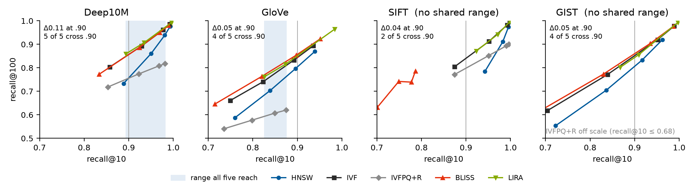
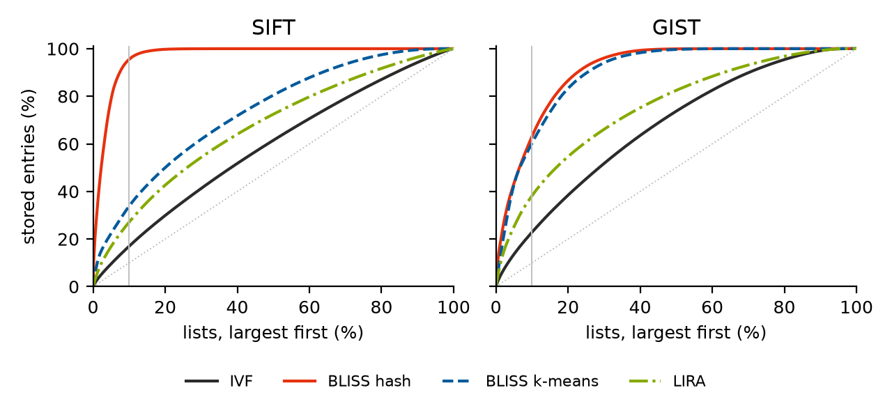

# What Recall Hides

**A diagnostic study of learned partition indexes for vector search**

Recall–throughput curves guide the choice of an approximate nearest neighbor (ANN) index, but they leave out
factors that decide whether two results can be compared at all. We study two learned partition indexes,
BLISS and LIRA, against three classical baselines on four corpora, and report what a matched recall@10 does not
show: whether the methods reach a common recall at all, how full their lists are, and where their time goes.

This repository holds the measurements and a script, [`reproduce.py`](reproduce.py), that recomputes every number
on the poster and in the 3-page paper from them.

`reproduce.py` recomputes every reported number from the recorded measurements; the code in `src/`, `cpp/`, `bindings/` and `scripts/` re-runs the methods themselves.

```bash
pip install -r requirements.txt
python reproduce.py                        # all 223 values, in seconds
python reproduce.py --download --figures   # also fetch and check the four corpora (8.7 GB), and redraw the plots
```

See [Reproducing the results](#reproducing-the-results) for what each step checks.

## Research questions

- **RQ1** Which recall levels permit a comparison across all tested methods, and how much retrieval quality at
  other cutoffs, and how much computational cost, does a matched recall@10 leave undetermined?
- **RQ2** How does the initial list assignment that MLP repartitioning starts from (hash or k-means) affect
  recall, scored candidates, and list balance?
- **RQ3** How large are the costs and the variability that recall comparisons omit?

## Methods

| Method | Initial lists | Router | Lists move | Copies / vector | Probing | Scan | Role |
|---|---|---|---|---|---|---|---|
| HNSW | — | graph | — | 1 | beam width | graph walk | baseline |
| IVF | k-means | nearest centroid | no | 1 | fixed budget | exact flat | baseline |
| IVFPQ+R | k-means | nearest centroid | no | 1 | fixed budget | PQ codes, exact re-rank | baseline |
| BLISS | hash | 4 MLPs | yes | 4 | fixed budget | exact by ID | learned |
| BLISS-KMeans | k-means | 4 MLPs | yes | 4 | fixed budget | exact by ID | initialization control |
| LIRA | k-means | probe MLP | no | learned, about 2 | score threshold | local HNSW | learned |

HNSW, IVF and IVFPQ+R come from Faiss 1.13.0; IVFPQ+R uses 16 eight-bit subquantizers and re-ranks a 256-vector
shortlist exactly. BLISS and LIRA are implemented from their papers. BLISS-KMeans is BLISS with its hash start
replaced by k-means and nothing else changed.

**Corpora** (all from ANN-Benchmarks, k = 10): Deep10M, 9.99 M × 96-d, cosine; GloVe, 1.18 M × 100-d, cosine;
SIFT, 1 M × 128-d, Euclidean; GIST, 1 M × 960-d, Euclidean. Deep10M and SIFT use all 10,000 queries, GIST its
1,000, and GloVe the first 1,000 of its 10,000.

**Protocol:** one dual-socket AMD EPYC 9124 host (32 cores), 32 serving threads, wall times as the median of three
trials after 32 warm-up queries, at batches of 1 and 256. BLISS recall is the mean of three seeds; other
configurations use one.

## RQ1: comparable levels, and what a match leaves open

**On SIFT and GIST no recall@10 level is reached by all five methods.** On SIFT, BLISS's highest recall@10 (0.79)
is below every other method's lowest (0.87); on GIST, IVFPQ+R tops out at 0.68 and overlaps only BLISS.

| Corpus | HNSW | IVF | IVFPQ+R | BLISS | LIRA | Shared range |
|---|---|---|---|---|---|---|
| Deep10M | 0.89–0.99 | 0.86–0.99 | 0.85–0.98 | 0.83–0.99 | 0.89–1.00 | **0.89–0.98** |
| GloVe | 0.76–0.94 | 0.75–0.94 | 0.74–0.87 | 0.71–0.95 | 0.83–0.98 | **0.83–0.87** |
| SIFT | 0.94–1.00 | 0.87–1.00 | 0.87–1.00 | 0.70–0.79 | 0.92–1.00 | **none** |
| GIST | 0.72–0.96 | 0.70–0.99 | 0.59–0.68 | 0.67–0.99 | 0.87–1.00 | **none** |

*Recall@10 range over each method's own sweep.*

**A matched recall@10 leaves recall@100 open by up to 0.11.** At recall@10 = 0.90, interpolated within each sweep,
recall@1 agrees within 0.02 but recall@100 does not:

| Corpus | HNSW | IVF | IVFPQ+R | BLISS | LIRA | Spread of recall@100 |
|---|---|---|---|---|---|---|
| Deep10M | 0.94 / 0.76 | 0.92 / 0.86 | 0.93 / 0.76 | 0.92 / 0.86 | 0.92 / 0.87 | 0.11 (5 methods) |
| GloVe | 0.93 / 0.80 | 0.93 / 0.84 | ↓0.87 | 0.93 / 0.86 | 0.92 / 0.85 | 0.05 (4 methods) |
| SIFT | ↑0.94 | 0.92 / 0.84 | 0.92 / 0.80 | ↓0.79 | ↑0.92 | 0.04 (2 methods) |
| GIST | 0.92 / 0.81 | 0.91 / 0.85 | ↓0.68 | 0.92 / 0.86 | 0.93 / 0.84 | 0.05 (4 methods) |

*Recall@1 / recall@100 at recall@10 = 0.90. ↑ / ↓: the sweep starts above or ends below 0.90, at the recall@10
shown, so it has no value there.*



Cost is not fixed by a recall@10 value either: at the same operating point, the wall time per query in a batch of
one is 1.9–19.9× the time in a batch of 256.

## RQ2: initialization and load balance

**At 40 probes per table on SIFT, a k-means start gains 0.192 recall@10 over BLISS's hash start, with 53% fewer
scored candidates.** The gain is 0.119–0.221 at every probe depth from 5 to 40. On GIST the direction reverses; on
Deep10M and GloVe the two starts differ by less than 0.01.

| Corpus | Recall@10, hash | Recall@10, k-means | Candidates (thousands), hash | Candidates (thousands), k-means |
|---|---|---|---|---|
| Deep10M | 0.989 | 0.990 | 173.4 | 216.2 |
| GloVe | 0.953 | 0.944 | 119.5 | 99.9 |
| **SIFT** | **0.803** | **0.995** | **155.6** | **73.1** |
| GIST | 0.984 | 0.956 | 144.5 | 142.6 |

*BLISS, seed 0, 40 probes per table; candidates are the mean scored per query.*

The start acts through the lists it leaves behind. Counting every physical list (each of BLISS's four tables
separately, empty lists kept), SIFT's hash start leaves 2,419 of 4,096 lists empty, against 20 for the k-means
start, and its largest 10% of lists hold 95.5% of all entries, against 33.8% (k-means start) and 17.0% (k-means
IVF). Every learned layout is less balanced than IVF on every corpus.

| Corpus | Largest / mean list: BLISS hash | BLISS k-means | IVF | LIRA | Empty lists: BLISS hash | BLISS k-means |
|---|---|---|---|---|---|---|
| Deep10M | 20.4 | 14.4 | 4.0 | 7.5 | 293 | 1,259 |
| GloVe | 15.7 | 10.2 | 2.8 | 10.2 | 175 | 205 |
| **SIFT** | **82.0** | **15.5** | **3.5** | 5.8 | **2,419** | **20** |
| GIST | 42.1 | 10.8 | 5.3 | 10.7 | 1,490 | 1,319 |

*Lists after training, seed 0. BLISS has 16,384 lists on Deep10M and 4,096 on the other corpora.*



**Near-saturation confounds partition quality with candidate retention.** SIFT's hash start scores 155,647
candidates per query on average against a buffer of 155,648, versus 73,146 for the k-means start. The mean does not
show how many queries hit the buffer; uncapped and equal-budget runs with more k-means seeds would settle it.

## RQ3: costs and variability

**Exact re-ranking dominates IVFPQ+R's search time.** With a fixed 256-vector shortlist, re-ranking costs a nearly
constant time per query that grows with dimension, while the compressed search stays cheap. From 10 to 100 probes
the search time grows 3.4–5.6× and re-ranking stays flat, so the per-point share falls from 77–95% to 37–85%: the
pooled share describes the sweep, not the method.

| Corpus | Dimension | Search (ms) | Re-rank (ms) | Re-rank share (%) |
|---|---|---|---|---|
| Deep10M | 96 | 0.027–0.153 | 0.092 | 54 |
| GloVe | 100 | 0.022–0.095 | 0.111 | 67 |
| SIFT | 128 | 0.015–0.065 | 0.153 | 81 |
| GIST | 960 | 0.034–0.113 | 0.675 | **91** |

*IVFPQ+R per query: search over the operating points (range) and exact re-ranking (mean).*

Building costs differ by orders of magnitude that no recall curve shows:

| Corpus | IVF build (s) | HNSW (×) | IVFPQ+R (×) | BLISS (×) | LIRA (×) | LIRA size (×) |
|---|---|---|---|---|---|---|
| Deep10M | 181 | 2.2 | 1.1 | 26 | 330 | 4.4 |
| GloVe | 21 | 3.0 | 1.2 | 61 | 330 | 4.3 |
| SIFT | 24 | 1.2 | 1.0 | 53 | 724 | 4.0 |
| GIST | 112 | 1.2 | 1.4 | 15 | 224 | 3.1 |

*Build time over the k-means IVF build of the same corpus, cached supervision excluded; size is LIRA's serving
footprint over IVF's. LIRA's build prices our implementation, not the method.*

Run twice at the same operating points, IVF and IVFPQ+R reproduce recall@10 exactly and HNSW within 0.0065. Three
BLISS seeds differ in recall@10 by up to 0.039 on SIFT and 0.027 on GIST at a single operating point.

## What to report next to recall

1. **A matched recall@10 is not a matched comparison.** Report each sweep's range, the targets it cannot reach,
   and recall at more than one cutoff.
2. **A large learned gain can belong to the starting partition.** Report physical-list occupancy, empty lists,
   candidate caps and per-query cap hits for every learned index.
3. **Much of the cost sits where the recall curve does not look.** A deployed index observes lists, candidates and
   timers, never recall: report stage times with the batch size, build accounting, and index seeds apart from
   timing repetitions.

**Limits:** four static corpora, one CPU host, our own implementations of the learned indexes, and one k-means seed
for the initialization control.

## Reproducing the results

`reproduce.py` runs in up to three steps and ends with one line: *All values match*, or how many differ.

1. **Measurements.** Every number on the poster and in the paper's tables and text is recomputed from the files in
   `data/` and compared with the number as printed. This takes a few seconds and needs no download. Add `-v` to
   see each value; the full comparison is also written to `out/values.csv`.
2. **Corpora.** [`download.py`](download.py) fetches the four ANN-Benchmarks files into `data/corpora/`, resumes an
   interrupted download, and checks each file's size and SHA-256 against the exact files the measurements were
   made on. `reproduce.py` then reads vector count, dimension, metric and query count from each file, and
   recomputes the exact top-10 neighbors of 100 sampled queries, comparing their distances with the ground truth
   shipped with the corpus (20 checks, about half a minute once downloaded). Run it with `--download`, or download first with `python download.py` (`--list` shows what is
   already there). Without the corpora, step 2 is skipped with a note.
3. **Figures** (`--figures`): redraws [`figures/recall.png`](figures/recall.png) and
   [`figures/occupancy.png`](figures/occupancy.png).

The exit status is 0 when everything matches, 1 when a value differs, and 2 when the setup is incomplete.

## Repository layout

| Folder / file | Holds |
|---|---|
| `data/`, `figures/`, `reproduce.py`, `download.py` | the recorded measurements, the plots, and the scripts that recompute every reported number from them |
| `src/` | the Python drivers (`cli_run_router_methods.py`, `cli_run_competitiveness.py`), the shared measurement harness, and `methods/` with the Faiss baselines (`faiss_baselines.py`), BLISS (`bliss.py`, `routers.py`) and LIRA (`lira.py`, `lira_runtime.py`) |
| `cpp/`, `bindings/`, `CMakeLists.txt`, `pyproject.toml` | the native exact-search module used by BLISS and BLISS-KMeans (C++17, OpenMP, pybind11) and its build |
| `scripts/` | `run_paper.sh`, the campaign driver, and `smoke_glove10k.sh`, a small end-to-end check |
| `env/` | the pinned environment that ran the campaign |

## Running the methods

This is the code that produced the measurements in `data/`, unchanged except for removed unrelated code and renamed identifiers.
It covers six configurations: HNSW, IVF, IVFPQ+R, BLISS, BLISS-KMeans and LIRA. BLISS and LIRA are implementations from their
papers, not the authors' code.

**Environment and build.** The campaign ran on Python 3.12.12 in the environment pinned in [`env/requirements-lock.txt`](env/requirements-lock.txt)
(`env/environment.yml` creates it from conda-forge). `scripts/run_paper.sh` builds the native module with CMake (Release, `-march=native`)
into `build/` and copies the shared library next to the Python sources; both are git-ignored.

```bash
conda env create -p ./work/env -f env/environment.yml      # or: pip install -r env/requirements-lock.txt
export PYTHON_BIN=$PWD/work/env/bin/python
```

**Smoke test** (10 000 GloVe vectors, one seed, about five minutes). The subset is prepared from `data/corpora/glove-100-angular.hdf5`
(`python download.py` fetches it); the campaign script does not prepare data itself:

```bash
mkdir -p /path/to/root/data/glove && ln -s $PWD/data/corpora/glove-100-angular.hdf5 /path/to/root/data/glove/
(cd src && PYTHONPATH=. $PYTHON_BIN -m datasets glove10k --data-root /path/to/root/data --download)
bash scripts/run_paper.sh --smoke --no-tmux --skip-preflight-smoke \
  --data-root /path/to/root/data --experiments-root /path/to/root/experiments --out-root /path/to/root/exports
```

**Full campaign** (four corpora and the original seeds; about 100 hours of stage time on the original hardware):

```bash
bash scripts/run_paper.sh --datasets glove,sift,gist,deep1m \
  --data-root <prepared data> --experiments-root <fresh dir> --out-root <fresh dir>
```

**What a run produces.** One directory per run cell under `--experiments-root`
(`<corpus>/<method>__seed<k>/<operating point>__<hash>/`) holding the index or model files, `competitiveness_summary.json` or
`query_sweep.json` (recall@1/10/100, scored candidates, timings, serving footprint) and per-query CSVs. The drivers also write
`initialization/` and `competitiveness/` summary tables under `--out-root`; logs go to `logs/`.

**Reading the results.** Timings depend on the machine; the original hardware was a dual-socket AMD EPYC 9124 with 32 cores.
HNSW and LIRA build HNSW graphs on several threads, so a rebuild can differ slightly: two original runs differed by up to
0.0065 recall@10. The original code initialises the BLISS routers without a fixed seed and this is kept unchanged, so BLISS and
BLISS-KMeans cells are not bit-reproducible either. The original campaign also ran a codes-only IVFPQ variant; it is not one of
the six configurations and is not included.

**Verification status.** On a 10 000-vector GloVe subset, two runs of the original code and one of the port produce byte-identical
Faiss indexes and identical recall and candidate counts for IVF and IVFPQ+R. HNSW and LIRA differ from run to run: between the two
original runs by up to 0.0064 recall@10 (HNSW) and 0.00024 recall@100 (LIRA), between the port and the originals by up to 0.004 and
0.0004. BLISS and BLISS-KMeans cannot be compared run against run, because of the unseeded initialisation; instead, one trained
router checkpoint was fed to the original and to the port, and the lists, assignments, recall and candidate counts came out identical
(the TensorFlow training function itself is unchanged but was not part of this comparison). Full-size reruns: pending.

## Data

| File | Content |
|---|---|
| [`data/corpora.csv`](data/corpora.csv) | vectors, dimension, distance, queries and IVF lists per corpus |
| [`data/operating_points.csv`](data/operating_points.csv) | per method, seed and operating point: recall@1/10/100, candidates scored, IVFPQ+R search and re-rank time, build time, serving footprint, wall time at batch 1 and 256 |
| [`data/operating_points_repeat.csv`](data/operating_points_repeat.csv) | recall@10 of HNSW, IVF and IVFPQ+R from a second, independent run |
| [`data/bliss_initialization.csv`](data/bliss_initialization.csv) | BLISS from its hash start (3 seeds) and from a k-means start (1 seed): recall@10 and candidates per probe depth |
| [`data/list_sizes.csv.gz`](data/list_sizes.csv.gz) | entries in every physical list after training, seed 0: IVF, BLISS from each start, LIRA |

**How the numbers are computed.** Values at recall@10 = 0.90 are interpolated linearly within each method's sweep.
Shares of entries in the largest lists are read off the cumulative curve in the occupancy plot. The re-rank share
pools exact re-rank time over search plus re-rank time across operating points. BLISS's candidate buffer is
1024 · ⌊2·R·N·m / (B·r) / 1024⌋ with R = 4 tables, N vectors, m = 40 probes, B lists per table and r = 2 minimum
repetitions, which is 155,648 on SIFT.

## References

- **ANN-Benchmarks:** M. Aumüller, E. Bernhardsson, A. Faithfull. Information Systems 87, 2020.
- **BLISS:** G. Gupta, T. Medini, A. Shrivastava, A. J. Smola. KDD 2022.
- **LIRA:** X. Zeng et al. WWW 2025.
- **HNSW:** Y. A. Malkov, D. A. Yashunin. IEEE TPAMI 42(4), 2020.
- **Product quantization; SIFT and GIST:** H. Jégou, M. Douze, C. Schmid. IEEE TPAMI 33(1), 2011.
- **Re-ranking:** H. Jégou, R. Tavenard, M. Douze, L. Amsaleg. ICASSP 2011.
- **Faiss:** J. Johnson, M. Douze, H. Jégou. IEEE Trans. Big Data 7(3), 2021; M. Douze et al. arXiv:2401.08281, 2024.
- **Deep:** A. Babenko, V. Lempitsky. CVPR 2016.
- **GloVe:** J. Pennington, R. Socher, C. D. Manning. EMNLP 2014.
